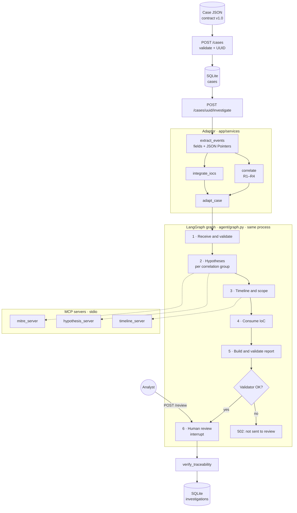

# Architecture

The integrated system has six pieces, each with a different job:

| Piece | What it does | Analogy | Where |
| --- | --- | --- | --- |
| **Intake** (FastAPI + Pydantic) | Validates the contract, assigns a UUID, stores the original case. | The front desk | `app/api/routes/cases.py`, `app/schemas/case.py`, `app/services/case_service.py` |
| **Adapter** | Extracts evidence, correlates alerts, links IoC and builds the agent input. | The case file assistant | `app/services/agent_adapter.py`, `evidence.py`, `correlation.py`, `ioc_integration.py` |
| **Skill** `soc-case-investigator` | Defines the procedure: phases, order, what may be claimed, report format. | The analyst manual | `skills/soc-case-investigator/` |
| **LangGraph graph** | Runs that procedure step by step, keeps state and pauses for human review. | The ticket workflow | `agent/graph.py` |
| **MCP servers** + `core/logic.py` | Do the analysis: MITRE mapping, attack chain, timeline. | The analyst's knowledge | `servers/`, `core/logic.py` |
| **Validators** | Skill validator (structure and references) and traceability check (evidence pointers). | Quality control | `skills/.../scripts/validate_report.py`, `app/services/traceability.py` |

## Diagram



## How a case travels

1. `POST /api/v1/cases` validates the envelope (Pydantic) and the semantic VR rules, assigns a UUID and stores the original payload in SQLite. Response `201`.
2. `POST /api/v1/cases/{uuid}/investigate` reads the stored record. No re-validation is done here.
3. `extract_events` collects the supported attributes of each alert, each with the JSON Pointer to where it was found.
4. `correlate` classifies every unordered pair of alerts. See [[16 Correlation engine]].
5. `integrate_iocs` links supplied intelligence to alerts. See [[17 IoC integration and traceability]].
6. `adapt_case` builds the agent input plus an `investigation_context` with the full original case.
7. The graph runs its six phases **in the FastAPI process**. Phase 2 analyses each correlation group separately.
8. The skill validator and the new traceability check verify the output.
9. The result is saved in SQLite and the graph stays paused at review.
10. `POST /review` resumes the same graph and saves the decision.

## The case state

`InvestigationState` in `agent/graph.py`:

| Key | Written by | Content |
| --- | --- | --- |
| `case` | input | The adapted case, including `investigation_context` |
| `alerts`, `input_summary` | phase 1 | Normalized alerts and input summary |
| `mitre_mappings`, `chain`, `attack_mapping`, `hypotheses` | phase 2 | MITRE mapping and hypotheses |
| `timeline`, `blast_radius` | phase 3 | Timeline and scope |
| `enrichment` | phase 4 | IoC items; also adds `ioc_evidence` to hypotheses |
| `report`, `report_markdown`, `validation` | phase 5 | Report and validator result |
| `audit_log` | all | One entry per phase. It **accumulates** (`operator.add`): each node appends, none deletes. |

## Why MCP

The analysis logic is split into independent servers that talk over [[14 Glossary#MCP|Model Context Protocol]]:

- Each server can be tested, logged and versioned on its own.
- The servers do not know each other; only the graph knows the order.
- The transport can move from stdio to HTTP (for example, separate containers) without touching `core/logic.py`.

| Server | MCP tool | Function in `core/logic.py` |
| --- | --- | --- |
| `mitre_server.py` | `map_to_mitre` | `map_alerts_to_mitre` |
| `hypothesis_server.py` | `generate_attack_hypothesis` | `generate_hypothesis` |
| `timeline_server.py` | `build_case_timeline` | `build_timeline` |
| `report_server.py` | `build_incident_report` | `generate_report` (original orchestrator only) |

## Why LangGraph

- **Guaranteed order:** the graph edges are fixed, so no phase can be skipped or reordered.
- **Typed state:** each phase receives exactly what the previous ones produced.
- **Pause and resume:** `interrupt()` and the checkpointer let the system wait for the analyst.
- **Audit:** the `audit_log` shows which phases ran, in what order and how long they took.

> [!note] LangGraph does not mean LLM
> LangGraph is a framework designed for LLM agents, but here it is used only to orchestrate the flow. See [[11 Where the LLM fits]].

## Architectural pattern (Yokoyama, 2019)

The previous version followed Yokoyama's pattern (*Machine Learning System Architectural Pattern for Improving Operational Stability*, ICSA-C 2019, DOI 10.1109/ICSA-C.2019.00055): business logic and the inference engine are kept separate, so faults can be located and the engine rolled back alone.

| Pattern goal | Previous version | Sprint 2 |
| --- | --- | --- |
| Separate business logic from engine | Process boundary: backend ran `agent/graph.py --json` as a subprocess | Module boundary: `app/` vs `agent/`, `core/`, `servers/` in one process |
| Locate faults | Investigation marked `failed` with the engine error | `502`/`504` response; the accepted case is kept and can be retried |
| Roll back the engine | Point `AGENT_DIR` to another copy | Revert `agent/`, `core/` or `servers/` in Git; the backend code does not change |

The trade-off was deliberate. Running in-process removes a Python and LangGraph start per case and the second virtual environment. In exchange, a hard crash inside the agent now affects the API process. See [[19 Changes from the previous version]].

## File map

```
soc-ai-analyst-sprint2/
├── app/                      # Backend (FastAPI)
│   ├── main.py               # Builds the app and both services
│   ├── api/routes/cases.py   # POST /cases (intake, unchanged)
│   ├── api/routes/investigations.py  # GET case/context/investigation, POST investigate/review
│   ├── schemas/              # Contract models (case.py) and output models (investigation.py)
│   ├── services/             # case_service, agent_adapter, evidence, correlation,
│   │                         # ioc_integration, traceability, investigation_service
│   ├── storage/case_store.py # SQLite: cases + investigations
│   └── core/config.py        # Environment settings
├── agent/                    # LangGraph graph, normalization, investigation, render
├── core/logic.py             # MITRE rules and business logic
├── servers/                  # 4 MCP servers
├── orchestrator/client.py    # MCP client (also used by the graph)
├── skills/soc-case-investigator/
├── data/                     # Synthetic, holdout cases and generated reports
├── examples/                 # Contract v1.0 samples
├── demo/                     # verify_local.py, run_pipeline.py, output/
├── docs/                     # Specification, implementation, verification, backlog
└── tests/                    # 184 tests
```

Next: [[06 The six phases]] · Back to [[00 Home]]
