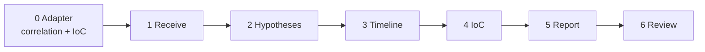

# The six phases

Each phase is a node of the graph in `agent/graph.py`. The order is set by [[08 The soc-case-investigator skill|the skill]] and cannot be changed. Node names stay in Spanish in the code, as in the original agent.



> [!info] Phase 0 is not a graph node
> When the case comes through the API, the backend adapter runs first: it extracts evidence, correlates alerts and links IoC (see [[16 Correlation engine]] and [[17 IoC integration and traceability]]). It marks the case with `adapter_version: "backend-v1"`. The phases below check for that mark and use the adapter's output. A CLI case has no mark and runs exactly as in the original agent.

---

## 1. Receive and validate · `recibir_validar`

**File:** `agent/normalize.py`

- Detects the format of each alert (ECS, Elastic Security, Wazuh or internal).
- Resolves each alert's native ID and normalizes host, user, IPs, rule and tags.
- Converts times to UTC, keeps the original and flags those without a zone.
- Logs missing fields, duplicate IDs and cases over 50 alerts.
- Looks for instruction-shaped text ("ignore previous instructions", "close the case") and logs it as untrusted data.

**With the adapter (new):**
- The ID is the wrapper `alert_id`; the format comes from `source_system`.
- `raw` is the full original `raw_alert`, not the working view.
- The UTC time comes from the evidence extractor, so correlation and timeline use the same value.
- Evidence warnings (for example a conflicting timestamp) are added to the input warnings.
- Non-string hosts or users and overflowing dates no longer crash the phase.

**Does not:** fill in missing data or drop alerts.

---

## 2. Investigate hypotheses · `investigar_hipotesis`

**Files:** MCP `map_to_mitre` and `generate_attack_hypothesis`, plus `agent/investigation.py`

1. Sends the alerts to the `mitre` server, which matches rule name and tags against the rule catalog (`RULES` in `core/logic.py`). Detail in [[10 Limitations#The rule catalog]].
2. Sends the result to the `hypothesis` server, which builds the attack chain ordered by tactic.
3. For each technique found it creates a **hypothesis** with:
   - evidence for: the matching alerts;
   - evidence against: alerts on the same host with legitimate-activity tags (`backup`, `scheduled_task`, `maintenance`, `change_approved`);
   - benign alternatives and missing data, by tactic;
   - **ordinal confidence** (see below).
4. Sorts hypotheses by confidence, then by tactic (initial access first).

### Analysis per correlation group

Alerts from the API come with their correlation. Since Sprint 3 (#38), cases run directly (`agent/run_synthetic.py`, the demo) are correlated too: `correlate_direct` wraps the alerts in the v1.0 contract only to run the same engine, and rewrites the evidence pointers into the case as given. If the case can't be wrapped (duplicate IDs, alerts outside the contract), the report says so in its limitations. Then `correlated_attack_analysis` splits the work:

- Each **related group** (a connected component of `related` pairs) is analysed on its own.
- Every alert outside a group (uncertain or unrelated) is analysed as a **singleton**.
- MITRE mappings are cut to the alerts of each group before the original hypothesis builder runs.

The effect: **an unrelated alert can no longer raise another group's confidence just because it matches the same technique**. Two unrelated brute-force alerts give two separate low-confidence hypotheses, not one medium one. Each hypothesis carries `correlation_group_alert_ids`, and each piece of evidence carries `source_fields` (path and value in the original case).

The global attack chain is kept, but its summary never states a sequence: it says techniques were evaluated per group and that correlation does not prove one.

### Confidence rule

Confidence values are written in Spanish in the report: `alta` (high), `media` (medium), `baja` (low), `insuficiente` (insufficient).

| Situation | Starting level |
| --- | --- |
| 3 or more alerts with at least 2 different rules | `alta` |
| 2 alerts | `media` |
| 1 alert | `baja` |
| none | `insuficiente` |

It then drops one level for each problem:

- there is evidence against;
- a supporting alert has a time without a zone, or an invalid time.

If the case has `synthetic: true`, it never goes above `media`.

> [!warning] Not a percentage
> `alta` does not mean 99%. It is an ordinal category with a written reason in `confidence_basis`. The MCP server computes an internal number (0.5 + 0.15 per alert), but the agent does not show it.

---

## 3. Timeline and scope · `cronologia_alcance`

**Files:** MCP `build_case_timeline`, plus `agent/investigation.py`

- **Timeline:** one entry per alert, sorted by time, with the original time, the UTC time and the stage (`initial_access`, `progression`, `impact`) derived from the tactic.
- **Scope (blast radius):**
  - **Observed:** every host that appears in an alert.
  - **Suspected:** hosts of medium- or high-confidence hypotheses.
  - **Confirmed:** always empty. The analyst decides.
  - **Suspected identities:** users of medium- or high-confidence hypotheses.
  - **Unknowns:** hosts of low or insufficient hypotheses ("ambiguous activity") and alerts without a host.

---

## 4. Consume IoC · `consumir_ioc`

**File:** `agent/investigation.py`, functions `consume_enrichment` and `attach_ioc_references`

- **With the adapter:** uses the IoC items the adapter already built (declared links and typed matches, with pointers). Status `provided`, or `no_disponible` if there are none. Then it adds `ioc_evidence` to every hypothesis whose supporting alerts are associated with an IoC. The role is always `context`: **it never raises confidence**.
- **Without the adapter (CLI):** as before. It searches each indicator by **exact value** in every text field of each alert, and records which alert and field matched.
- If an indicator matches no alert, the note says so.

**Does not:** query reputation or external services. An IoC that is not enriched does not rule out the incident.

---

## 5. Build and validate the report · `generar_validar_reporte`

**Files:** `agent/graph.py`, `agent/investigation.py`, `agent/render.py`

1. Builds the JSON report with the skill's schema 1.1. Detail in [[07 Reading the report]].
2. **With the adapter:** adds `correlation` and `submitted_case_id`, and appends the correlation limitations.
3. Generates the **recommended actions** from the tactics (`ACTIONS_BY_TACTIC` in `core/logic.py`):
   - priority by tactic: impact and exfiltration are `urgent`; lateral movement and credentials, `high`; initial access, `medium`;
   - drops one level if the hypothesis has low confidence;
   - insufficient-confidence hypotheses produce no actions;
   - all carry `requires_human_approval: true`.
4. Writes the limitations.
5. Renders the Markdown draft with the skill template, now including IoC evidence per hypothesis and an "alert correlation" section.
6. Runs `validate_report.py` as a separate process, **with a 60-second timeout** (new). **If it fails, the graph ends** and the case does not reach review.

After the graph pauses, the backend also runs `verify_traceability` (see [[17 IoC integration and traceability#Traceability check]]). If that fails, the API answers `502`.

---

## 6. Human review · `revision_humana`

**File:** `agent/graph.py`

- Calls `interrupt()` with the draft. The graph stops and `review.status` stays `pending` (the API shows `pending_review`).
- When the decision arrives (`submit_review`, or `POST /review` through the API), it accepts only `validated`, `corrected` or `rejected`, with analyst and notes. Anything else is an error.
- Records the decision and date in the report and adds the sixth entry to the `audit_log`.
- `corrected` records the status and notes; it does not rewrite individual findings.

---

## The audit log

Each phase appends an entry like this:

```json
{"phase": 2, "node": "investigar_hipotesis", "finished_at": "2026-10-09T12:10:07Z",
 "duration_ms": 11, "detail": "2 técnicas candidatas, 2 hipótesis"}
```

The report includes the entries for phases 1 to 4 in `audit_trail`. The final graph state, which the API returns as `audit_log`, has all of them.

Next: [[07 Reading the report]] · Back to [[00 Home]]
