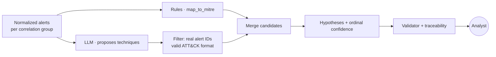

# Where the LLM fits

> [!important] Short answer
> **The system does not call any language model at runtime.** There are no calls to Claude, OpenAI or any other model in the code. Sprint 2 did not add one. The report itself declares this in its limitations.

## Where AI does appear

| Moment | LLM? | Detail |
| --- | --- | --- |
| **Procedure design** | Yes | The skill was written as instructions for an AI agent. V3 was tested by applying it by hand with a model. |
| **Development** | Yes | Code, test cases and reports were produced with help from Claude. |
| **Runtime** | **No** | The skill rules are translated to Python. The analysis is the five rules in `core/logic.py`; correlation and IoC linking are deterministic too. |
| **LangGraph** | No | A framework for LLM agents, but here it only orchestrates the flow. |

That is why we call it an "agent" by its **structure** (state, phases, tools, human pause), not by its **reasoning**.

## How to explain it to the team

> "We have the full skeleton of the agent: intake, correlation, the procedure, the flow, the audit trail, two validators and human review. What reasons today is still rules, not a language model. The LLM is the next step, and it already has a place to plug in with controls around it."

## Benefits and costs of adding one

| Without LLM (today) | With LLM |
| --- | --- |
| The same case always gives the same report | The same case can give different reports |
| Only sees what the catalog names | Can recognize techniques described with any name |
| No cost per case | Token cost per case |
| Data never leaves the machine | Alerts travel to an external provider |
| Does not hallucinate | Can invent techniques or cite alerts that do not exist |

The skill controls (validator, ordinal confidence, nothing confirmed, human review) matter **more** with an LLM than without one. They are what stops a hallucination from reaching the analyst as fact. Sprint 2 adds one more such control: the **traceability check**, which rejects any evidence pointer whose value does not match the original case.

## Where it would plug in

The natural place is **phase 2**, `investigar_hipotesis`, inside each correlation group:

- The model receives the alerts as **data** and the skill rules as instructions.
- Its output goes through a filter: cited alerts that do not exist and malformed technique IDs are dropped.
- The current rules stay as a second opinion. If rule and model agree, confidence can go up; if they disagree, it is flagged for the analyst.
- Everything else (correlation, phases 3 to 6, validators, review) stays the same.

The step-by-step guide, with sample code, is in [[12.4 Adding an LLM node]].

## Decide before adding it

- **Data:** does the client allow sending alerts, even anonymized, to a model provider? Today only simulated data is used.
- **Measurement:** without analyst-labeled cases you cannot tell whether the LLM improves or worsens results. See [[12.6 Measuring precision]].
- **Cost and latency:** the requirement is at most 5 minutes for 50 alerts, and `POST /investigate` is synchronous.

Next: [[12 Improving the agent]] · Back to [[00 Home]]
