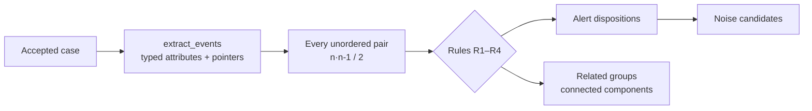

# Correlation engine

**User story US2.** Decide which alerts in a case observe the same activity, which do not, and which cannot be decided, without discarding anything.
**Files:** `app/services/evidence.py` (field extraction), `app/services/correlation.py` (rules), `app/schemas/investigation.py` (output models).
**Algorithm ID:** `entity-time-v1`.

> [!important] Conservative by design
> Correlation is **independent of ATT&CK**. Time alone, a rule name, a shared MITRE technique or a correlation label sent by the submitter **never** make two alerts related. `related` means "shared observed entities", not "same attack".

## How it works



1. `extract_events` reads the supported fields of each alert (nested keys, flat dotted keys and the `_source` envelope). Each value keeps its **JSON Pointer** and original value.
2. `correlate` compares every unordered pair. Complexity is O(n²): 50 alerts produce 1,225 pair records.
3. Each pair gets a classification, a rule, an explanation, the time delta and its evidence.
4. Each alert gets a disposition. Related pairs form groups.

## Fields it compares

| Family | Fields | Comparison |
| --- | --- | --- |
| Network | `source.ip`, `destination.ip`, `data.srcip`, `data.dstip`, `host.ip`, `agent.ip`, `source_ip`, `dest_ip` | Parsed IPv4/IPv6 (canonical form) |
| User | `user.name`, `data.srcuser`, `data.dstuser`, `user`; `user.id` | Exact. Names and IDs are separate kinds |
| Host | `host.name`, `host.hostname`, `agent.name`, `host`; `host.id`; `agent.id` | Exact. The Wazuh agent ID has its own namespace |
| Process | `process.entity_id` | Exact. A PID alone is not used |
| Session | `session.id` | Exact |
| Artifact | `file.hash.*`, `process.hash.*` (MD5, SHA-1, SHA-256) | Valid hex length, case-insensitive |
| Time | `@timestamp`, `timestamp` | Timezone-aware, compared as UTC instants |

Kinds inside a family are kept apart so that, for example, a username never matches a user ID. A **family counts once**: two shared IPs are still one family. Domain, URL and email fields are extracted too, but only for IoC matching, not for correlation.

### Time evidence

A time gives no temporal evidence when it is missing, malformed, without a zone, or when an alert carries two **conflicting** times. `submitted_at` is never used as a substitute. These cases add a warning to the alert.

## The rules

Default window: **300 seconds**, inclusive.

| Rule | Classification | When |
| --- | --- | --- |
| **R1** | `related` | At least **two** entity families share a value **and** both times are valid and within the window |
| **R2** | `uncertain` | Some family shares a value, but there is no second family or no reliable close time |
| **R3** | `unrelated` | Nothing shared across at least two **comparable** families |
| **R4** | `uncertain` | Nothing shared, and fewer than two families can be compared |

Why two families: an IP alone can be NAT or a proxy, a user alone can be a shared account, and a hash alone can be a common tool. Two independent signals close in time are much harder to explain away.

R3 means "unrelated under this limited profile", not proof that a relationship is impossible. R4 means "absence of evidence is not disproof".

## Output

### Pairs (`relationships`)

```json
{
  "relationship_id": "rel-0001",
  "alert_ids": ["ecs-auth-001", "wazuh-auth-002"],
  "classification": "related",
  "rule": "R1",
  "explanation": "At least two entity families match within the time window",
  "time_delta_seconds": 120,
  "evidence": [
    { "kind": "ip", "assessment": "shared", "observation": "Shared ip: 192.0.2.50",
      "fields": [ { "alert_id": "ecs-auth-001", "path": "/alerts/0/raw_alert/source/ip", "value": "192.0.2.50" },
                  { "alert_id": "wazuh-auth-002", "path": "/alerts/1/raw_alert/data/srcip", "value": "192.0.2.50" } ] },
    { "kind": "time", "assessment": "temporal", "observation": "Events are 120 seconds apart; window 300s", "fields": ["..."] }
  ]
}
```

`assessment` is one of `shared`, `distinct`, `temporal` or `missing`. Distinct evidence is kept too, so the analyst can see what was compared and did **not** match.

### Alert dispositions (`alerts`)

| Disposition | When |
| --- | --- |
| `related` | At least one of its pairs is related |
| `uncertain` | No related pair, and at least one uncertain pair (or no peers at all) |
| `unrelated` | Every pair is unrelated → **noise candidate** |

### Groups and noise

- `related_groups`: connected components of related pairs. A group does **not** mean every pair inside it is directly related (A–B and B–C related does not make A–C related).
- `noise_alert_ids`: alerts whose disposition is `unrelated`. They stay in the case and are still investigated, as singletons.

## How the agent uses it

In phase 2, each related group is analysed on its own and every other alert is analysed alone. An unrelated alert cannot raise another group's confidence just because it matches the same technique. See [[06 The six phases#New in Sprint 2: analysis per correlation group]].

The report includes the full `correlation` object, and the Markdown draft has an "alert correlation" section listing each pair.

## Example: the Sprint 2 demo

| Pair | Result | Why |
| --- | --- | --- |
| ecs-auth-001 / wazuh-auth-002 | `related` (R1) | Same IP, user and host, 120 s apart, across Elastic and Wazuh |
| ecs-auth-001 / ecs-uncertain-004 | `uncertain` (R2) | Same host only; IP and user differ, so one family is not enough |
| wazuh-auth-002 / ecs-uncertain-004 | `uncertain` (R2) | Same reason |
| ecs-noise-003 / any | `unrelated` (R3) | Host, IP and user all comparable, nothing shared |

Result: one group (`ecs-auth-001`, `wazuh-auth-002`), one noise candidate (`ecs-noise-003`).

## Changing the window

The window is a parameter of `correlate()` and `InvestigationService(store, window_seconds=...)`. It must be positive. It does not change the input contract. There is no environment variable for it yet.

## Limits

- Correlation is not causation; related entities can still be benign activity.
- Names are compared exactly. Tenant or domain scoping (`jdoe` vs `CORP\jdoe`) needs customer validation.
- Unknown custom fields are kept but not compared until mappings are verified.
- Session-ID scoping per source needs customer validation.
- Tests show behavior on synthetic data, not real-world accuracy. See [[12.6 Measuring precision]].

Next: [[17 IoC integration and traceability]] · Back to [[00 Home]]
